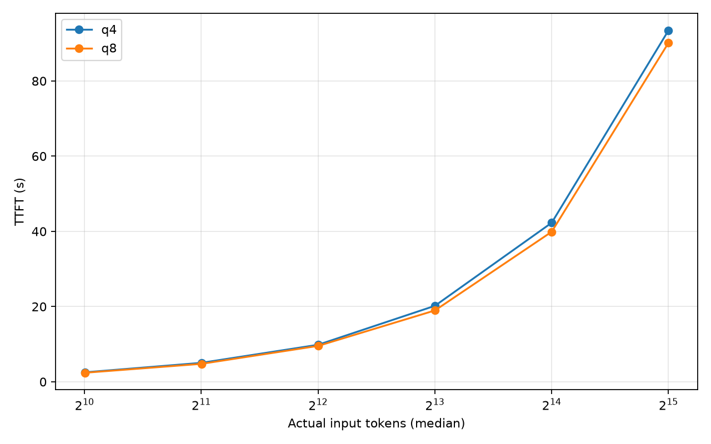
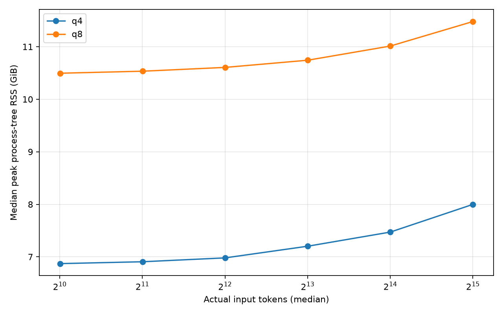
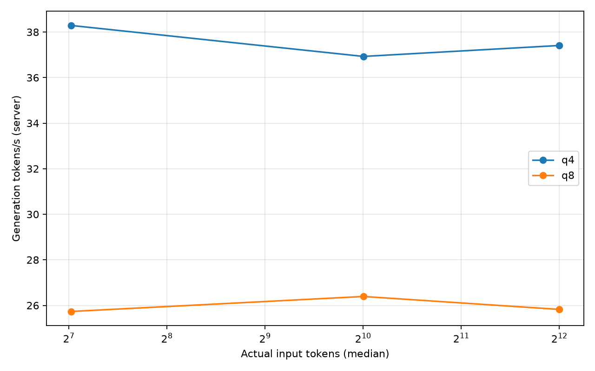
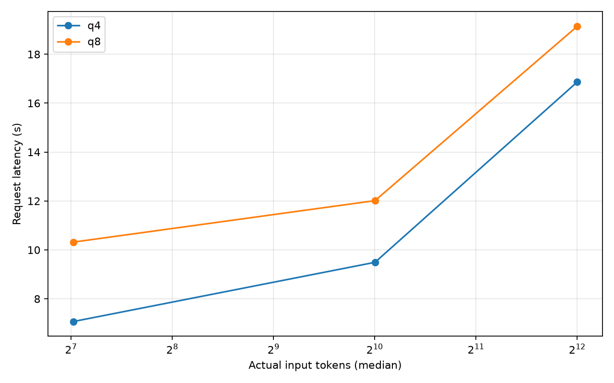

# Результаты измерений

Медианы рассчитаны отдельно для каждой конфигурации и длины входа. Неполные группы не используются для сравнений. Память - RSS дерева процессов, включая служебные расходы; это не точный объём Metal-аллокаций.

Конфигурации: q4 = Qwen3.5-9B Q4_K_M; q8 = Qwen3.5-9B Q8_0. Движок, методика и ограничения сравнения описаны в [README](../README.md). Оба квантования измерены при питании от зарядки. Фоновая нагрузка могла различаться.

| Модель | Тест | Вход, токены (медиана) | Успехи | TTFT, с | Токенов/с | Latency, с | RSS до, ГиБ | Пик RSS, ГиБ (медиана / максимум) |
|---|---|---:|---:|---:|---:|---:|---:|---:|
| q4 | speed | 130.000 | 3/3 | 0.416 | 38.290 | 7.071 | 6.903 | 7.008 / 7.008 |
| q4 | speed | 1026.000 | 3/3 | 2.585 | 36.929 | 9.493 | 6.903 | 7.070 / 7.079 |
| q4 | speed | 4098.000 | 3/3 | 10.066 | 37.410 | 16.867 | 6.908 | 7.083 / 7.083 |
| q4 | context | 1026.000 | 3/3 | 2.516 | 37.860 | 9.236 | 6.704 | 6.871 / 6.873 |
| q4 | context | 2050.000 | 3/3 | 5.042 | 36.419 | 12.033 | 6.741 | 6.907 / 6.911 |
| q4 | context | 4098.000 | 3/3 | 9.848 | 36.899 | 16.795 | 6.806 | 6.980 / 6.980 |
| q4 | context | 8194.000 | 3/3 | 20.205 | 35.518 | 27.748 | 7.020 | 7.202 / 7.203 |
| q4 | context | 16386.000 | 3/3 | 42.293 | 33.842 | 49.815 | 7.273 | 7.472 / 7.478 |
| q4 | context | 32770.000 | 3/3 | 93.440 | 30.703 | 101.749 | 7.771 | 7.999 / 8.008 |
| q4 | context (неполная группа) | цель 65536 | 0/3 | - | - | - | - | - / - |
| q8 | speed | 130.000 | 3/3 | 0.408 | 25.733 | 10.318 | 10.538 | 10.642 / 10.643 |
| q8 | speed | 1026.000 | 3/3 | 2.350 | 26.391 | 12.014 | 10.534 | 10.701 / 10.705 |
| q8 | speed | 4098.000 | 3/3 | 9.272 | 25.823 | 19.144 | 10.541 | 10.803 / 10.809 |
| q8 | context | 1026.000 | 3/3 | 2.401 | 25.021 | 12.593 | 10.327 | 10.495 / 10.496 |
| q8 | context | 2050.000 | 3/3 | 4.772 | 24.537 | 15.166 | 10.364 | 10.534 / 10.536 |
| q8 | context | 4098.000 | 3/3 | 9.547 | 24.530 | 19.945 | 10.431 | 10.606 / 10.608 |
| q8 | context | 8194.000 | 3/3 | 18.970 | 25.025 | 29.113 | 10.560 | 10.743 / 10.745 |
| q8 | context | 16386.000 | 3/3 | 39.895 | 22.894 | 50.696 | 10.812 | 11.012 / 11.014 |
| q8 | context | 32770.000 | 3/3 | 90.141 | 22.125 | 101.673 | 11.296 | 11.479 / 11.561 |

## Границы проверенного контекста

- q4: целевая длина 32768, фактический вход 32770 токенов; 3/3 успешных повтора. Медиана TTFT 93.440 с; максимальный наблюдаемый RSS 8.008 ГиБ. На следующей ступени 65536 токенов запрос превысил лимит 120 с.
- q8: целевая длина 32768, фактический вход 32770 токенов; 3/3 успешных повтора. Медиана TTFT 90.141 с; максимальный наблюдаемый RSS 11.561 ГиБ. Более длинные входы не проверялись; максимальный рабочий контекст не установлен.

Завершение всех выбранных ступеней даёт нижнюю границу рабочего контекста. Таймаут запроса означает практическое временное ограничение, а не доказательство нехватки памяти.

## Неуспешные запросы

- q4, цель 65536, повтор 1: TimeoutError: Request exceeded 120s wall-clock limit; время до ошибки 120.003 с; наблюдаемый пик RSS 8.753 ГиБ. Полный ответ не получен; успешные TTFT и throughput не подставляются.

## Исходные прогоны

- `logs/2026-09-30T12-21-56.290161+00-00-q4-speed`: complete; все выбранные длины пройдены.
- `logs/2026-09-30T12-27-31.078251+00-00-q4-context`: complete; все выбранные длины пройдены.
- `logs/2026-09-30T13-16-52.909049+00-00-q4-context`: stopped; запрос превысил лимит 120 с.
- `logs/2026-09-30T13-28-21.483350+00-00-q8-speed`: complete; все выбранные длины пройдены.
- `logs/2026-09-30T14-52-53.060283+00-00-q8-context`: complete; все выбранные длины пройдены.

